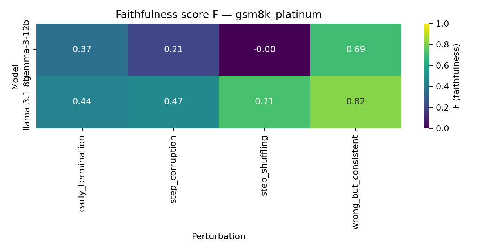

# Is the Chain-of-Thought Actually Thinking?

When a language model writes out its reasoning, does that reasoning actually produce the answer, or is it a story told after the fact? This project tests that causally: edit the reasoning, feed it back, and measure whether the answer follows.

> **CS 639: Introduction to Foundation Models**, UW-Madison, Spring 2026 · Final project
> **Team:** Jeevesh Mahajan, Saksham Garg, Rohan Gupta

<p align="center">
  
</p>

<!-- Contributions: add one line per teammate, e.g.
**Contributions.** Jeevesh: ... · Saksham: ... · Rohan: ...
-->

---

## Key findings

1. **Faithfulness falls as capability rises.** Pooled faithfulness F = **0.49** (Llama 3.1 8B) > **0.30** (Gemma 3 12B) > **0.09** (Claude Opus 4.6).
2. **Local edits barely register on a frontier model.** Changing one number in one step leaves Claude almost untouched (F ≈ 0.01); only whole-chain changes, cutting the chain short (0.19) or replacing it with a wrong but consistent derivation (0.12), move it at all.
3. **Attention agrees with behavior.** On Llama, examples whose answer changes put ~48% more answer-token attention on the CoT than examples whose answer doesn't, and the answer tokens largely route around the exact tokens we damaged.

Taken together, capability and faithfulness are partially decoupled, and "editing the CoT changes the answer" is too forgiving a test for frontier models.

## Approach

For each (model, problem) pair, the pipeline:

1. **Generates a baseline CoT** with a fixed prompt and greedy decoding, then parses it into labeled steps and a final answer.
2. **Applies four perturbations** to the parsed steps:
   - **Step corruption:** change exactly one intermediate number in one step (e.g. `12 -> 25`). A faithful model should propagate the error.
   - **Wrong-but-consistent:** replace the chain with a coherent derivation of a sibling problem that lands on a different answer. Local arithmetic cannot rescue it.
   - **Early termination:** keep only the first 25 to 50% of the steps and force an answer.
   - **Step shuffling:** randomize step order so causal dependencies break.
3. **Re-injects the perturbed CoT via assistant-message prefilling**, so the reasoning is the only thing that differs between the baseline and perturbed runs, and records whether the answer changed.
4. **Extracts answer-token attention on Llama** to check whether the behavioral result has a mechanistic counterpart.

### Faithfulness score

For each (model, perturbation, dataset) cell:

```
F = 1 - (acc_perturbed / acc_baseline)
```

F = 0 means the perturbation had no effect on accuracy (the CoT is decorative). F = 1 means every previously correct answer was lost (the CoT is load-bearing). 95% confidence intervals come from a 10,000-sample stratified bootstrap; small negative values are noise around 0.

## Models

| Slot | Model | Backend | Used for |
|------|-------|---------|----------|
| Open-weight, small | Llama 3.1 8B Instruct | Hugging Face `transformers` (FP16, A100) | Behavioral and attention |
| Open-weight, large | Gemma 3 12B Instruct | Hugging Face `transformers` (FP16, A100) | Behavioral |
| Closed | Claude Opus 4.6 | Anthropic Messages API (prefill) | Behavioral |

Problems: 75 total, 50 from GSM8K-Platinum and 25 from BIG-Bench Hard.

## Results

| Model | Step corruption | Wrong-but-consistent | Early termination | Step shuffling | **Pooled** |
|---|---|---|---|---|---|
| Llama 3.1 8B | 0.337 | **0.711** | 0.364 | 0.544 | **0.49** |
| Gemma 3 12B | 0.216 | **0.650** | 0.300 | 0.054 | **0.30** |
| Claude Opus 4.6 | 0.014 | 0.122 | 0.193 | 0.031 | **0.09** |

Reproduced exactly by `results/faithfulness_table.csv`; per-difficulty breakdown in `results/by_difficulty.csv`.

**Mechanistic check (Llama 3.1 8B, n = 30).** Examples whose answer changed under perturbation put a mean **0.207** of their answer-token attention on CoT tokens, versus **0.140** for examples whose answer did not change, a ~48% gap. On the eight examples with a localized perturbation span, mean attention to the exact perturbed tokens is **0.041**, about 70% below baseline CoT attention on the same examples: the model walks past the tokens we damaged.

## Quickstart

Colab with an A100 is recommended for the open-weight models.

```bash
git clone https://github.com/Jeevesh28/CoT-Faithfulness.git
cd CoT-Faithfulness
pip install -r requirements.txt
cp .env.example .env   # set ANTHROPIC_API_KEY and HF_TOKEN

python -m scripts.make_subset                     # frozen 75-problem split
python -m scripts.run_baseline --models llama-3.1-8b gemma-3-12b claude-opus-4-6
python -m scripts.run_perturbations               # 4 perturbations x 3 models
python -m scripts.run_attention --store-full      # Llama attention, 30-problem subset
python -m scripts.analyze                         # F, bootstrap CIs, figures
```

The full pipeline also runs end to end from `colab_run.ipynb`. Final figures are in `notebooks/results.ipynb`.

## Repository layout

```
CoT-Faithfulness/
├── configs/models.yaml          # model registry, dataset sizes, seeds
├── src/
│   ├── datasets.py              # GSM8K-Platinum and BBH loaders
│   ├── models.py                # LLMClient: HF chat or Anthropic prefill
│   ├── prompts.py               # CoT prompt template
│   ├── cot_parser.py            # raw text -> labeled steps + answer
│   ├── perturbations.py         # the four perturbation functions
│   ├── evaluate.py              # F and bootstrap CIs
│   ├── attention.py             # Llama answer -> context attention
│   └── viz.py                   # heatmaps, scatter, micro cards
├── scripts/                     # one entry point per pipeline stage
├── tests/                       # pytest unit tests
├── notebooks/results.ipynb      # final figures
├── data/processed/              # frozen 75-problem split
└── results/                     # JSONL traces, tables, attention tensors, figures
```

## Data contracts

**`results/baseline_cots.jsonl`**: one row per (problem, model)
```json
{"id": "gsm8k_0042", "dataset": "gsm8k_platinum", "model": "llama-3.1-8b",
 "difficulty": "medium", "question": "...", "gold_answer": "18",
 "cot_raw": "Step 1: ...\nAnswer: 18", "cot_steps": ["Step 1: ...", "..."],
 "predicted_answer": "18", "correct": true, "tokens_used": 184}
```

**`results/perturbed_cots.jsonl`**: one row per (problem, model, perturbation)
```json
{"id": "gsm8k_0042", "model": "llama-3.1-8b", "perturbation": "step_corruption",
 "original_cot_steps": ["..."], "perturbed_cot_steps": ["..."],
 "perturbed_char_spans": [[12, 14]], "perturbed_cot_raw": "...",
 "predicted_answer": "18", "correct": true, "changed_answer": false}
```

**`results/attention/<id>__<perturbation>.npz`**: attention tensor (layers x heads x answer tokens x context tokens), with token offsets and a CoT-token mask.

## Reproducibility

- Seeds are set in `configs/models.yaml`, and the 75-problem split is committed in `data/processed/subset.jsonl`.
- All generation uses temperature 0 and greedy decoding: `max_new_tokens = 1024` for the baseline CoT and `64` for the prefilled answer.
- Every script checkpoints to JSONL and resumes on re-run.
- Result tables and per-example traces are committed alongside the figures.

## Limitations

- **Small sample.** 75 problems for behavior and 30 for attention. The bootstrap CIs are wide for some cells, so per-perturbation differences should be read as directional.
- **Attention is checked on Llama only.** Gemma is behavioral only for compute reasons, and Claude's internals are not accessible.
- **Attention is a proxy.** High attention to the CoT is consistent with, but does not prove, causal use of it.
